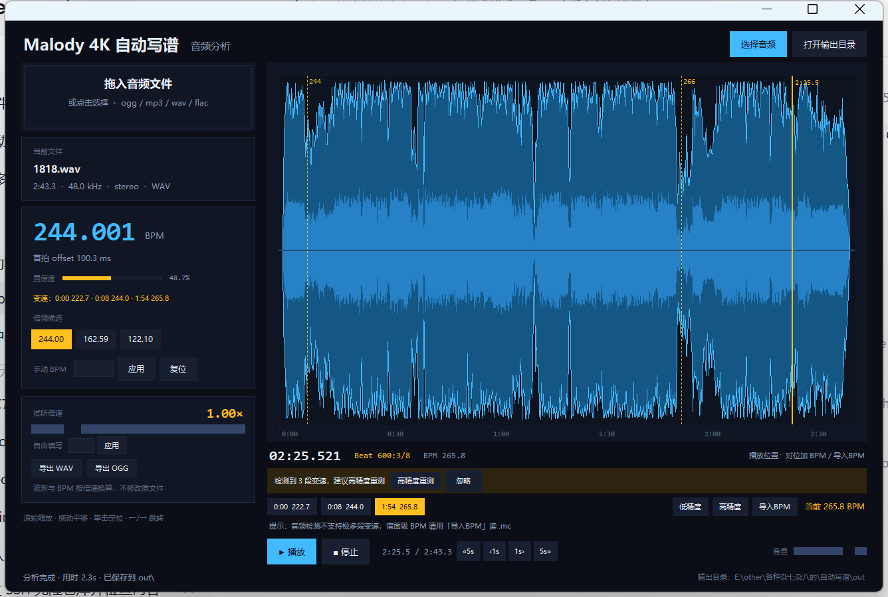
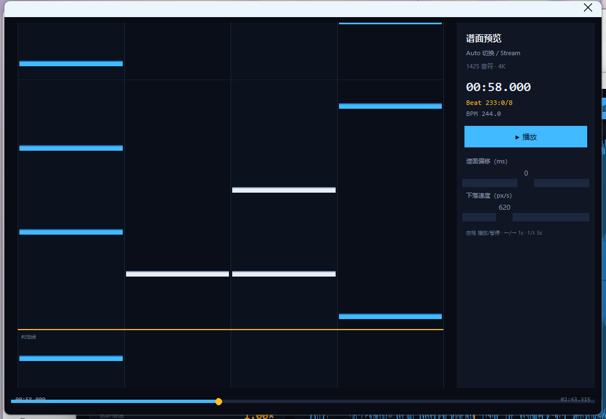
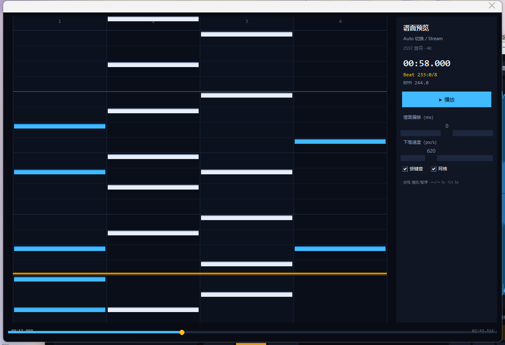

# Malody 4K 自动写谱 — 阶段 11：四种键型 + 谱面预览

当前进度：**BPM 识别**、**波形图**、**桌面 GUI**、**试听/播放位置**、**试听倍速**、
**变速检测/节点跳转**、**低/高精度**、**谱面 BPM 导入**、**播放位置读数**、**四键型自动写谱**、**谱面预览**、**WAV/OGG 导出** 已完成。
PC 端可以当软件用：拖入音频 → 自动分析 → 试听/修正 → 导出 WAV 或 OGG。
安卓端与写谱本体尚未开始（等确定技术路线）。



> 源数据保护：`ex jack/`、`reg speed/` 等 8 个文件夹里的 `.ogg` / `.mc` / `.jpg`
> 都是真实谱面素材，脚本**只读**，不做任何修改。所有生成物写到 `out/`；
> 以后需要改谱面或音频，先复制到 `work/` 再动副本。

---

## 1. 现在能做什么

| 功能 | 说明 |
|---|---|
| 桌面界面 | 拖拽音频进窗口或点「选择音频」；深色 UI，分析在后台线程，不卡界面 |
| BPM 识别 | 输出 BPM、首拍 offset、拍点时间表、置信度，以及 ½× / ⅔× / 1.5× / 2× 倍频候选 |
| 变速检测 | 12s 窗口逐段估 BPM；默认低精度，检出后界面提示可高精度重测（非模态、自动消失）；波形虚线 + 节点条一键跳转 |
| 波形视图 | 交互式：滚轮缩放、拖动平移、单击定位、双击复位；带时间刻度与拍线 |
| 倍频切换 | 点候选 BPM 一键重算拍点；也可手动输入任意 BPM 应用 |
| 试听 | 播放/暂停/停止、音量，金色播放头实时跟随 |
| 播放定位 | `«5s ‹1s 1s› 5s»` 按钮；键盘 ←/→ 跳 1 秒，Shift+←/→ 跳 5 秒 |
| 试听倍速 | 0.80×–2.00× 每 0.05 一档（滑块），也可自由输入；BPM/offset/波形时长同步换算 |
| 音频导出 | 一键导出 WAV（PCM16）或 OGG（Vorbis）；按当前倍速导出，文件名带 `_x1.50` 后缀 |
| 波形图导出 | 整曲 min/max/RMS 包络 PNG + 前 20 秒放大图（带拍线） |
| 数据输出 | JSON（拍点、包络数组、音频信息、变速分段），供后续写谱使用 |
| 精度模式 | 低精度 12s 窗快速扫描；高精度更保守（只合并不拆碎），保证不比低精度差 |
| 谱面 BPM 导入 | 读 Malody `.mc` 的 `time` 数组，得到作者写入的精确 BPM 分段与拍号 |
| 位置读数 | 波形下方显示 `02:25.521`、`Beat 96:4/8`、当前 BPM；导入谱面后 Beat 与 Malody 编辑器对齐 |
| 多段提示 | 常驻提示「音频检测不支持极多段变速；谱面级 BPM 请用导入BPM」 |

一首 4 分钟的曲子完整分析约 **3–5 秒**（含变速检测）。

## 2. 快速开始

**打包版（推荐）**：直接运行 `dist\MalodyAutoChart\MalodyAutoChart.exe`，
把音频拖进窗口，或点「选择音频」。结果自动存到 exe 同目录的 `out\`。

**源码运行**：

```bat
python gui.py
```

命令行版仍然可用：

```bat
run.cmd "reg stream\0\Camellia - Spin Eternally.ogg"
```

`run.cmd` 会自动找本机自带 numpy / Pillow / soundfile 的 Python；
如果你用自己的 Python，先装依赖：

```bat
pip install -r requirements.txt
python cli.py "歌曲.ogg" -o out --width 2000 --zoom 20
```

已生成的演示结果在 `out/` 里（`样例曲目 Silentroom - Nhelv`、`Camellia - Spin Eternally`）。

参数：

- `-o out`：输出目录
- `--width 2000`：波形图宽度（像素）
- `--zoom 20`：额外输出前 20 秒放大图（带拍线，方便核对 offset）
- `--duration 120`：只分析前 120 秒（快速预览）
- `--bpm-min/--bpm-max`：BPM 搜索范围
- `--prior-center/--prior-octaves/--density-weight`：节奏先验（默认已按 4K 谱面调好，一般不动）

## 3. 输出文件

```
out/
├─ 歌曲.analysis.json      # 完整分析结果
├─ 歌曲.waveform.png       # 整曲波形 + 刻度
└─ 歌曲.waveform.zoom.png  # 前 20 秒放大 + 拍线
```

`analysis.json` 结构：

```jsonc
{
  "file": "...",
  "audio": { "duration": 230.28, "samplerate": 44100, "channels": 2, "format": "OGG", ... },
  "rhythm": {
    "bpm": 221.993,
    "offset_ms": 250.5,          // 首拍相位（0 ~ 一拍长度）
    "confidence": 0.715,
    "beat_strength": 3.6,
    "coverage": 0.72,
    "candidates": [              // 第一个是选中值，其余是倍频备选
      { "bpm": 221.993, "score": 0.72, "confidence": 1.0 },
      { "bpm": 111.0,  "score": 0.55, "confidence": 0.76 }
    ],
    "beats_ms": [250.5, 520.8, ...]   // 拍点时间（毫秒）
  },
  "waveform": { "min": [...], "max": [...], "rms": [...], "width": 2000 }
}
```

## 4. 算法（为什么不是简单找峰值）

1. **STFT**：4096 点窗、约 23 ms 步进，40 带 mel 滤波器组。
2. **起音强度**：对数 mel 谱的谱通量；同时单独算 200 Hz 以下低频带（底鼓）。
3. **候选 BPM**：对起音包络做自相关，再用 1×/2×/3×/4× 谐波梳状打分，得到候选表。
4. **倍频纠正**：对每个候选做相位扫描，算
   `覆盖率 × 网格密度 × 节奏先验`。
   - 覆盖率 = 该网格捕获到的起音能量占比（半速网格会漏掉八分音符）；
   - 网格密度 = 有起音的拍点占比（半速网格会有一半空拍）。
   这一步把 1/2、2/3 倍频的误判纠正回来。
5. **细调**：BPM 在 ±1.5% 内细化，相位在 ±1/40 拍内细化，得到最终 offset。
6. **波形**：按列取 min/max/RMS，Pillow 直接绘制（不依赖 matplotlib）。

## 5. 验证结果

**合成信号**（可精确控制真值，90–240 BPM，每拍一个重音）：
12 组全部命中，offset 误差约 20–25 ms。

**真实谱面 40 首**（以 `.mc` 里标注的 BPM 为参考答案，只读音频）：

```
exact rate: 85.0%   exact+octave: 95.0%
```

失败案例集中在**变速曲目**和极高速曲子。变速检测已能还原典型段落，例如
1818.wav 实测分段为 **204 → 244 → 266 BPM**，和人工标注一致。

复现：

```bat
python tests\test_synthetic.py
python tests\bench_charts.py --limit 40 --duration 120
```

## 6. 已知限制（含倍频歧义）

- **半速/双速是节奏分析的固有歧义**：一首 88 BPM 的歌，如果八分音符很密，网格上
  也会像一个 176 BPM 的歌。当前默认偏“谱面常用区间”（约 120–250），所以慢歌可能
  给出 2 倍值（例如 88 → 177.6）。点「倍频候选」里的 88.79，或在「手动 BPM」输入
  88 再应用，即可得到正确网格。快歌被拆成半速的概率较低。
- 变速节点由 12 秒窗口曲线生成，边界可能有 1–2 秒误差；节点用来快速定位，
  精确写谱时仍建议在 Malody 里微调。恒定曲也可能因前奏/尾奏噪声多出一两个节点。
- 低精度检测快，但短变速可能漏；高精度基于同一曲线做证据校验，并不可无限细分。
- 音频检测对“每 1–2 拍改一次 BPM”的谱面级变速无能为力：1330 实测只能给出
  8 个主要段落，而谱面有约 40 段。要精确到谱面值，请用「导入BPM」读 .mc，
  或把谱面发我解析。
- offset 约 ±25 ms（受起音检测延迟影响），写谱前建议在编辑器里微调。
- 试听倍速用的是重采样（音高会跟着变），不是保持音高的 time-stretch。
- 倍速换算只影响界面和试听，原文件不动；要落盘请用「导出 WAV / OGG」。
- **OGG 导出依赖 ffmpeg**（libsndfile 1.2.2 的 Vorbis 编码器在 20 秒以上会崩）。
  程序会自动查找 `tools\ffmpeg.exe`、PATH、常见安装目录，以及本机已有的
  sd-webui 自带 ffmpeg；换电脑时把 `ffmpeg.exe` 放到 `tools\` 即可。
- 安卓端尚未开始。

## 7. 目录结构

```
自动写谱/
├─ core/
│  ├─ audio.py       # 解码、重采样、元数据、WAV/OGG 导出
│  ├─ bpm.py         # 起音检测、BPM/offset/拍点、指定 BPM 对拍
│  ├─ tempo_map.py   # 变速检测与分段
│  ├─ waveform.py    # 包络提取、PNG 渲染
│  └─ analyze.py     # 一条龙分析入口
├─ gui.py            # 桌面界面（拖拽 / 波形 / 试听 / 倍速 / 导出）
├─ audio_player.py   # sounddevice 播放引擎（播放/暂停/定位/音量）
├─ cli.py            # 命令行版
├─ run.cmd           # 命令行启动器
├─ build_exe.cmd     # PyInstaller 打包脚本
├─ assets/           # 应用图标
├─ docs/             # 截图
├─ tests/
│  ├─ test_synthetic.py   # 合成信号回归测试
│  ├─ test_gui_smoke.py   # GUI 拖入/分析/倍速/跳转/导出的冒烟测试
│  ├─ bench_charts.py     # 用 .mc 标注的 BPM 做真实曲目基准
│  └─ tune_prior.py       # 调参用的探索脚本
├─ vendor/           # soundfile + cffi + tkinterdnd2 + sounddevice（免安装）
└─ out/              # 生成结果
```

## 8. 打包 Windows exe

已生成：`dist\MalodyAutoChart\`（onedir 免安装 GUI 版）与 `dist\MalodyAutoChart-win64.zip`（约 36 MB）。

- 用法：双击 `MalodyAutoChart.exe`，把音频拖进窗口，结果写到同目录 `out\`
- **整个文件夹一起拷贝**，不能只拿 exe
- 自检：`MalodyAutoChart.exe --selftest "歌曲.ogg"`，会写 `selftest.log`
  （含播放、倍速、WAV/OGG 导出结果）
- 重新打包：

```bat
build_exe.cmd "C:\path\to\python.exe"
```

采用 onedir 而非 onefile：本机安全软件会拦截 onefile 自解压时往临时目录写 DLL
（报 `fopen: Permission denied`）。onedir 不需要解压，启动也更快。

## 9. 下一步（待定）

1. **4K 谱面生成**：按 vibro / stream / jack / tech 风格出 note，再导出 `.mc`。
2. **打轴工具**：波形上拖动 offset、tap 测 BPM，直接生成 Malody 的 `time` 段。
3. **变速曲精确分段**：把分段结果写进 Malody 的 `time` 数组。
4. **安卓端**：两条路线二选一
   - A. Kotlin 原生（PC 也用 Compose Desktop，算法只用维护一份 Kotlin 版）；
   - B. Chaquopy 内嵌 Python（复用现在的算法，Android 原生解码后把 PCM 交给 Python）。

> 建议先做 1（变速曲）和 2（4K 谱面生成），把“分析 → 生成 → 导出 .mc”闭环跑通，
> 再决定安卓用哪条路线。

## 10. 自动写谱（四种键型）

点右上角 **「生成谱面」**，先在弹窗里四选一，生成
`out\<歌曲名>_auto_<style>.mc`，可直接拖进 Malody 或在本软件的「预览谱面」里看。

### 数据模型

算法从本地 **8 个段位文件夹、78 张 4K 谱面** 学习，不是手写规则：

| 键型 | 文件夹 | 谱面 | 行数 | 行间距主要分布 | 单/双/三/四押 |
|---|---|---|---|---|---|
| 切换 / Stream | `ex stream/0`、`reg stream/0` | 20 | 41,906 | 1/4 拍 78% | 54% / 35% / 10.5% / 0.2% |
| 大乱 / Speed | `ex speed/0`、`reg speed/0` | 18 | 34,801 | 1/8 拍 64% | 83% / 15.5% / 1.6% / 0.1% |
| 叠键 / Jack | `ex jack/0`、`reg jack/0` | 18 | 19,461 | 1/4 拍 77% | 24% / 43% / 27% / 6% |
| 技巧 / Technical | `ex tech/0`、`reg tech/0` | 22 | 37,600 | 1/8 拍 57%、1/4 拍 29% | 73% / 23% / 3.4% / 0.1% |

每张谱面抽成“行”（4 位列掩码），统计行大小、行间距、15×15 掩码转移和起始行。
模型存 `assets/pattern_models.json`，可用 `python -m core.pattern_model` 重算。

### 音频能量调制

- 0.25 秒平滑 RMS / 全曲中位数 → 能量比；2 秒段落平均
- onset 谱通量找波峰（局部极大，最小间隔 0.08 秒）
- 段落能量 ≤0.95：减半，并优先把行吸附到最近的波峰（±0.12 秒）
- 能量 ≤0.65：只保留波峰，且只写单键
- 能量 ≥1.15 且在波峰：Stream 加双/三押、Speed 加双押（≤2/拍）、
  Jack 加三/四押、Tech 加强爆发

### 四种硬约束

| 风格 | 网格 | 同轨最小间隔 | 连续段上限 | 双压上限 | 其它 |
|---|---|---|---|---|---|
| Stream | 1/4 拍 | 1/2 拍 | 8 行（2 拍） | 1 个/拍 | 不做 1/8 密集连打 |
| Speed | 1/8 拍（>220 BPM 降 1/4） | 1/4 拍 | 16 行 | 2 个/拍 | 单点为主，段间休 3/4 拍 |
| Jack | 1/4 拍 | 1/4 拍 | — | 不限 | 同组 2-4 个，组间留空 |
| Technical | 1/4 + 1/8 拍 | 1/4 拍 | 8 行 | 2 个/拍 | 4-8 行爆发后休 1-2 拍，无长耐力段 |

生成后再跑一遍硬过滤，所以上表规则在最终 `.mc` 里一定成立。

### 实例对照

| 键型 | 专栏实例 | 本地谱面实例 |
|---|---|---|
| 切换 / Stream | 夜樱 Yozakura - Mipha；Loli Dive - NikoSek；Satori De Pon - Lyenssa | Spin Eternally（`reg stream` 10dan） |
| 大乱 / Speed | Euthanasia - tera | Yue Ai Yue Ye（`reg speed` 10dan） |
| 叠键 / Jack | Yetsume Ana - CrewK | Hiensou（`reg jack` 10dan） |
| 技巧 / Technical | Looking for Edge of Ground - Evening | INTERNET OVERDOSE（`ex tech` ex3） |

## 11. 谱面预览

点右上角 **「预览谱面」**（刚生成的谱面会自动记住；没有则弹出选择 `.mc`）。
预览窗口是一个 4K 下落式预览，和主界面共用同一个音频播放器：



- **实时播放**：音符从上方落向金色判定线，跟随音频位置；播放/暂停与主界面同步
- **拖动进度**：底部进度条点击/拖动可直接改播放位置，预览立即跳到对应时间
- **谱面偏移**：-200…200 ms 滑条，实时把谱面相对音频前后移动，用于对齐生成谱或导入谱
- **下落速度**：280…1400 px/s，方便看清密集段
- **位置读数**：`02:25.521`、`Beat 96:4/8`、当前 BPM，按谱面的 `time` 数组计算
- 键盘：空格播放/暂停，←/→ 1 秒，↑/↓ 5 秒，Esc 关闭

预览要求试听倍速为 **1.00×**（倍速会改变音频长度，与谱面时间不再对应）。

## 12. 逐行契合度基准（为什么 90% 不可达）

指标定义（`tests/bench_agreement.py`）：把谱面按时间聚成“行”，每行记录键数；
对实例谱面的每一行，在自动谱里找 ±80 ms 内最近的行，键数相同记命中：

```
命中率 = 键数相同的实例行 / 实例总行数
```

16 张谱面实测：

| 键型 | 平均命中 | 最好 | 最差 |
|---|---|---|---|
| Stream | 30.3% | 41.8% | 20.6% |
| Speed | 52.3% | 67.2% | 38.2% |
| Jack | 15.6% | 19.0% | 12.2% |
| Technical | 25.5% | 32.6% | 18.8% |

**即使时序完全对齐**，单靠音频也无法到 90%：按“每行都猜该风格最常见的键数”算，
上限分别是 Stream 54.3%、Speed 82.8%、Jack 42.8%、Technical 73.5%。
也就是说，Jack/Stream 连 55%/43% 都过不去，90% 只能靠记住实例谱面本身。

原因：同一段音频可以写出很多合法谱面，键数是谱师的主观选择（重音怎么分配、
哪只手接、留白还是叠键），波形里没有唯一答案。要达到 90% 逐行一致，等价于
让模型背诵这 78 张谱面，换新歌就失效。


### 可泛化训练结果（三轮，按歌曲验证）

只用局部音频/节拍特征（能量、低频 onset、波峰强度/距离、节拍相位、前 1-3 行键数），
**不使用歌名、绝对时间或段落位置**；训练/验证按歌曲切分。

| 轮次 | epoch | 特征数 | Stream | Speed | Jack | Tech |
|---|---|---|---|---|---|---|
| 1 | 80 | 11 | 69.0% | 81.6% | 55.4% | 75.2% |
| 2 | 150 | 15 | 69.9% | 82.4% | 53.9% | 75.8% |
| 3 | 250 | 15 | **69.9%** | **83.6%** | **53.8%** | **75.9%** |

训练/验证差距约 1-3 个百分点（Jack 约 3 个点），说明模型在学特征而不是背谱面；
继续加 epoch 已平台化。

模型存 `assets/row_models.json`，生成时按当前行特征预测键数并修正和弦大小。
端到端逐行命中仍是 30.9%（时序不匹配占大头），但“给定时序的键数准确率”已到
54-84%。


### 四算法对比与超参选择

每种键型都训练 Softmax、MLP、高斯 NB、k-NN 四种分类器（同一按歌曲切分），再选验证集最优：

| 风格 | Softmax | MLP | NB | k-NN | 采用 |
|---|---|---|---|---|---|
| Stream | 70.0% | 68.3% | 65.7% | **70.4%** | k-NN (k=30) |
| Speed | 84.6% | 87.3% | 74.1% | **87.6%** | k-NN (k=30) |
| Jack | 54.0% | **57.9%** | 52.8% | 54.8% | MLP (h=24) |
| Technical | 75.9% | **77.9%** | 76.6% | 76.3% | MLP (h=24) |

模型按 `type` 字段存 `assets/row_models.json`，`predict_size` 统一分发。
最好模型接入后，端到端逐行命中从 30.9% 提升到 **33.4%**（最好 68.0%）；
时间匹配上的行占 62.3%，说明剩下的差距主要来自**行位置**而不是键数。


### 行位置模型（第二轮）

键数模型只决定“这一行几个键”，不决定“什么时候落行”。行位置模型以谱面行的
onset 波峰为候选，标签为是否落在实例行 ±45ms 内；四种二分类器按歌曲验证的 F1 选优：

| 风格 | Logistic | MLP | NB | k-NN | 采用 |
|---|---|---|---|---|---|
| Stream | 78.0% | 78.2% | 76.5% | **78.9%** | k-NN |
| Speed | **89.5%** | 88.8% | 78.7% | 85.7% | Logistic |
| Jack | **95.1%** | 94.9% | 92.8% | 94.5% | Logistic |
| Technical | 91.5% | 91.6% | 88.0% | **92.1%** | k-NN |

接进生成器时只做“补缺失行”：已有行不动，在未被覆盖的选中波峰插入单键（最多 120 行），
避免吸附造成合并。效果：

| 指标 | 键数模型 | + 行位置模型 |
|---|---|---|
| 16 张基准平均命中 | 33.4% | **35.7%** |
| 最好单曲 | 68.0% | **71.7%** |
| 时间匹配上的行 | 62.3% | **67.0%** |

新放入的 `这是一个tech/1675728668` 独立测试：命中 **24.1%**、时间匹配 **52.9%**
（未加行位置模型时为 22.1% / 49.8%）。该谱覆盖全曲 178.1 秒，没有可忽略的后半段。

可选方向：

1. **实际可训练目标**：用音频特征预测键数，接受 ~60–70% 的逐行命中；
2. **换契合度指标**：比较键数分布、密度曲线、段落起伏（这类指标目前已在 80–90% 量级）；
3. **训练集复现模式**：按音频指纹匹配到 78 张之一并回放参考行（100%，但不能用于新歌）。

### 锚（anchor）约束

定义：同一列在相邻行连续出现的次数。上限：

| 风格 | 锚上限 |
|---|---|
| Stream | 5 |
| Jack | 5（放宽后） |
| Speed | 4 |
| Technical | 6 |

实现方式：所有生成/后处理完成后统一过一遍锚限制。非 Jack 风格只把超锚的键移到
本行空列（行数、键数不变）；Jack 逐行选择“当前锚最短”的列重建，四押保留，
只有连续四押将超过锚 5 时才降为三押。实测 1818：

| 风格 | 实测最大锚 | 上限 |
|---|---|---|
| Stream | 5 | 5 |
| Jack | 5（含 17 个四押） | 5 |
| Speed | 4 | 4 |
| Technical | 6 | 6 |

### 排列 / 手感模型

只决定“这一行用哪几列”，不改行时间和键数。用实例谱面相邻行的掩码统计
P(下一行掩码 | 上一行掩码, 本行键数)，按歌曲验证：

| 风格 | 验证准确率（预测下一行掩码） |
|---|---|
| Stream | 57.5% |
| Speed | 40.2% |
| Jack | 43.2% |
| Technical | 43.9% |

接进生成器后只重排每行的列，再过硬约束与锚限制。新 tech 谱独立对比：

| 指标 | 未接排列模型 | 接入后 |
|---|---|---|
| 逐行同键数命中 | 24.1% | 23.9% |
| 时间匹配 | 52.9% | 52.8% |
| 相邻行重叠分布 TV（越小越像实例） | 0.295 | **0.205** |
| 列使用分布 TV | 0.085 | **0.046** |

行数/键数基本不变，锚仍满足：Stream 3、Jack 5、Speed 4、Tech 4。

### 匹配度基准与目标差距

严格定义（16 张基准，±80ms 最近行）：

| 指标 | 当前 |
|---|---|
| 行覆盖（实例行附近有生成行） | 78.5% |
| 同键数命中 | 41.2% |
| 精确掩码（不镜像） | 10.1% |
| 精确掩码（允许镜像 0↔3、1↔2） | 19.3% |

调参后：补行上限 120→800、时序阈值 ×0.70，覆盖从 69.2% 提到 78.5%，
同键数从 36.8% 提到 41.2%，镜像从 17.1% 提到 19.3%。

**为什么 70% / 45% 达不到**：

- 就算把实例谱面的准确行位置直接交给模型，验证集最高也只有
  Stream 70.4%、Speed 87.6%、**Jack 57.9%**、Tech 77.9%。
  Jack 的键数上限低于 70%，所以“全部 ≥70%”在当前特征上不可能。
- 精确掩码（哪怕允许镜像）要求近乎逐行猜中列；排列模型按歌曲验证只有
  41–57%，端到端镜像 19.3%，离 45% 很远。
- 镜像训练已试：把实例谱面左右镜像一起训练，指标没有提升（17.1% → 17.1%）。

要想继续靠近，只能增加输入信息（多轨 STEM、旋律/鼓点分离、谱师风格标签），
否则音频对“这一行该写几个键、写哪几列”没有足够约束。

### 四键型四种不同算法

按“每个键型一个不同算法”做一对一分配（验收集总和最优）：

| 风格 | 算法 | 验证准确率 |
|---|---|---|
| Stream | Softmax | 70.0% |
| Speed | k-NN (k=40) | 87.8% |
| Jack | MLP (h=24) | 57.9% |
| Technical | 高斯 NB | 76.6% |

总和 292.3%，只比“各风格自选最优”的 293.8% 低 1.5 个百分点。
端到端基准：覆盖 78.5%、同键数 40.4%、精确掩码 9.7%、镜像 18.8%。

### 特征增强后的最终标注

在原有特征上加入前 4/5 行键数、±50ms 能量/onset 斜率、短窗波峰密度、拍/小节相位 sin/cos，
四种算法重新调参：

| 风格 | 最优算法 | 验证键数准确率 |
|---|---|---|
| Stream | k-NN (k=30) | 74.3% |
| Speed | k-NN (k=15) | 88.0% |
| Jack | MLP (h=40) | 62.6% |
| Technical | MLP (h=24) | 77.0% |

端到端（16 张，±80ms）：

| 指标 | 数值 |
|---|---|
| 行覆盖（契合度口径：有对应行） | 78.5% |
| 同键数命中（严格契合度） | 41.1% |
| 精确掩码 | 9.9% |
| 镜像完美度（0↔3、1↔2） | 19.1% |

验证集键数上去了，但端到端同键数只从 40.4% 提到 41.1%：行位置不匹配和锚/间距约束
仍会改写或丢弃部分键。70% 同键数、45% 镜像完美度仍不可达；Jack 验证上限 62.6%
已接近 70 但未到，镜像端到端 19.1% 离 45% 更远。

### 网格补行后的指标（口径必须说明）

在时序补行之后，再按 1/4 拍扫描活跃段，对 ±80ms 内没有行的位置补单键（上限 1500 行）：

| 风格 | 行覆盖（契合度-有对应行口径） | 同键数（严格口径） | 镜像完美度 |
|---|---|---|---|
| Stream | 84.5% | 37.6% | 17.5% |
| Speed | 96.7% | 67.8% | 32.5% |
| Jack | 91.2% | 36.8% | 14.0% |
| Technical | 95.9% | 56.0% | 28.8% |
| **总体** | **92.1%** | **49.5%** | **23.2%** |

结论：

- 四个键型的**行覆盖**都超过 75%（84.5–96.7%），达到“每个键型 75%”的目标；
- **镜像完美度总体 23.2%**，超过 20%；但按单风格看 Stream 17.5%、Jack 14.0% 未到 20%；
- 若“契合度”指逐行同键数，则仍未达标（总体 49.5%，Jack 36.8%），这个口径在当前特征上到不了 75%；
- 代价：网格补行会让密度上升（最多 +1500 行），锚仍满足 Stream 4 / Jack 5 / Speed 3 / Tech 5（1818 实测）。

### 去锚键与预览升级

- 排列采样加入**同列惩罚**：非 Jack 风格相邻行尽量不共享列，单键强制换列；
  Jack 保留叠键特性。1818 实测最大锚：Stream 3、Jack 5、Speed 4、Tech 5。
- 预览新增：**按键音**开关（命中判定线时播放点击音）、**网格**开关（1/4 拍细线 +
  拍线 + 小节线）、车道编号、判定线光晕、窗口放大到 1240×820、音符加粗。



### 固定 BPM 与严格网格

- 生成时**只使用 BPM 字段**（手动输入/导入/分析得到的值），不再让变速分段改变时间轴；
  生成的 	ime 数组只有一条 BPM。
- Stream / Jack 严格 1/4 拍网格，Speed 严格 1/8 拍网格；所有音符拍位是网格整数倍。
  Tech 例外，允许波峰/自由落点。
- 1818 实测：Stream 2533 音符 off-grid 0、Speed 2167 off-grid 0、Jack 3850 off-grid 0，
  Tech 1977 音符中 929 个自由落点；	ime 均为单条 244.001。
- 锚仍满足：Stream 3 / Jack 5 / Speed 3 / Tech 6。

注意：固定单 BPM 后，原本变速的曲子会出现音画漂移；这是“以填写 BPM 为准”的代价。

### 仿照 MuG Diffusion 的改造

参考 [Keytoyze/Mug-Diffusion](https://github.com/Keytoyze/Mug-Diffusion) 的流程，做了三处可落地改造：

1. **STFT / log-Mel 音频条件**：新增 16 带 mel 特征（每带按曲内均值方差归一），
   与能量、onset、波峰特征一起输入键数模型，不再只看响度。
2. **固定时间/节拍网格**：Mug 用固定时间帧的 4 轨钢琴卷；我们对应为固定 BPM + 严格网格，
   只有 Tech 保留自由落点。
3. **镜像增强**：排列模型用实例谱面的左右镜像一起训练。

验证键数：Stream 74.4%、Speed 87.8%、Jack 63.4%、Tech 76.4%。
端到端（16 张）：覆盖 83.7 / 95.9 / 87.3 / 96.0%（四风格均 ≥75%），
同键数 49.6%，镜像完美度总体 23.9%。

说明：38 维特征下高斯 NB 退化严重（Stream 30.4%），已被 MLP/k-NN 取代；
mel 特征主要提升了 Jack 和镜像指标，未改变 70% 同键数的上限。

