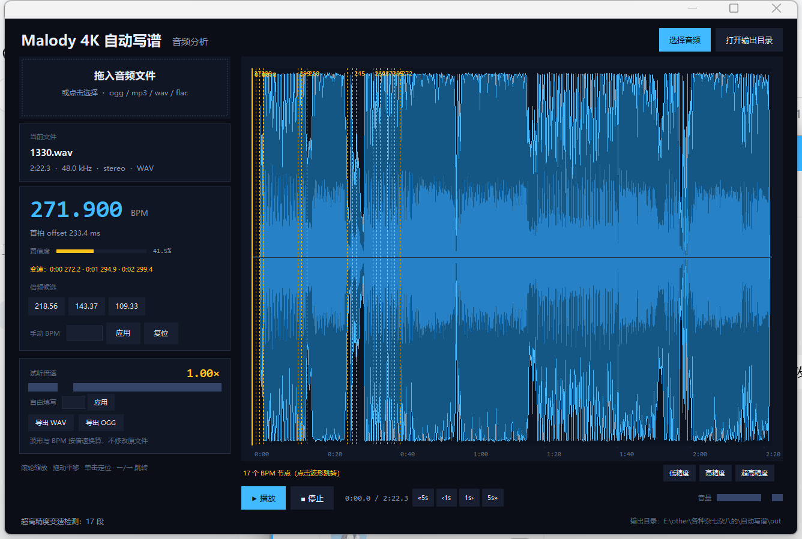

# Malody 4K 自动写谱 — 阶段 7：超高精度变速曲线

当前进度：**BPM 识别**、**波形图**、**桌面 GUI**、**试听/播放位置**、**试听倍速**、
**变速检测/节点跳转**、**低/高/超高精度**、**WAV/OGG 导出** 已完成。
PC 端可以当软件用：拖入音频 → 自动分析 → 试听/修正 → 导出 WAV 或 OGG。
安卓端与写谱本体尚未开始（等确定技术路线）。



> 源数据保护：`ex jack/`、`reg speed/` 等 8 个文件夹里的 `.ogg` / `.mc` / `.jpg`
> 都是真实谱面素材，脚本**只读**，不做任何修改。所有生成物写到 `out/`；
> 以后需要改谱面或音频，先复制到 `work/` 再动副本。

---

## 1. 现在能做什么

| 功能 | 说明 |
|---|---|
| 桌面界面 | 拖拽音频进窗口或点「选择音频」；深色 UI，分析在后台线程，不卡界面 |
| BPM 识别 | 输出 BPM、首拍 offset、拍点时间表、置信度，以及 ½× / ⅔× / 1.5× / 2× 倍频候选 |
| 变速检测 | 12s 窗口逐段估 BPM；默认低精度，检出后界面提示可高精度重测（非模态、自动消失）；波形虚线 + 节点条一键跳转 |
| 波形视图 | 交互式：滚轮缩放、拖动平移、单击定位、双击复位；带时间刻度与拍线 |
| 倍频切换 | 点候选 BPM 一键重算拍点；也可手动输入任意 BPM 应用 |
| 试听 | 播放/暂停/停止、音量，金色播放头实时跟随 |
| 播放定位 | `«5s ‹1s 1s› 5s»` 按钮；键盘 ←/→ 跳 1 秒，Shift+←/→ 跳 5 秒 |
| 试听倍速 | 0.80×–2.00× 每 0.05 一档（滑块），也可自由输入；BPM/offset/波形时长同步换算 |
| 音频导出 | 一键导出 WAV（PCM16）或 OGG（Vorbis）；按当前倍速导出，文件名带 `_x1.50` 后缀 |
| 波形图导出 | 整曲 min/max/RMS 包络 PNG + 前 20 秒放大图（带拍线） |
| 数据输出 | JSON（拍点、包络数组、音频信息、变速分段），供后续写谱使用 |

一首 4 分钟的曲子完整分析约 **3–5 秒**（含变速检测）。

## 2. 快速开始

**打包版（推荐）**：直接运行 `dist\MalodyAutoChart\MalodyAutoChart.exe`，
把音频拖进窗口，或点「选择音频」。结果自动存到 exe 同目录的 `out\`。

**源码运行**：

```bat
python gui.py
```

命令行版仍然可用：

```bat
run.cmd "reg stream\0\Camellia - Spin Eternally.ogg"
```

`run.cmd` 会自动找本机自带 numpy / Pillow / soundfile 的 Python；
如果你用自己的 Python，先装依赖：

```bat
pip install -r requirements.txt
python cli.py "歌曲.ogg" -o out --width 2000 --zoom 20
```

已生成的演示结果在 `out/` 里（`样例曲目 Silentroom - Nhelv`、`Camellia - Spin Eternally`）。

参数：

- `-o out`：输出目录
- `--width 2000`：波形图宽度（像素）
- `--zoom 20`：额外输出前 20 秒放大图（带拍线，方便核对 offset）
- `--duration 120`：只分析前 120 秒（快速预览）
- `--bpm-min/--bpm-max`：BPM 搜索范围
- `--prior-center/--prior-octaves/--density-weight`：节奏先验（默认已按 4K 谱面调好，一般不动）

## 3. 输出文件

```
out/
├─ 歌曲.analysis.json      # 完整分析结果
├─ 歌曲.waveform.png       # 整曲波形 + 刻度
└─ 歌曲.waveform.zoom.png  # 前 20 秒放大 + 拍线
```

`analysis.json` 结构：

```jsonc
{
  "file": "...",
  "audio": { "duration": 230.28, "samplerate": 44100, "channels": 2, "format": "OGG", ... },
  "rhythm": {
    "bpm": 221.993,
    "offset_ms": 250.5,          // 首拍相位（0 ~ 一拍长度）
    "confidence": 0.715,
    "beat_strength": 3.6,
    "coverage": 0.72,
    "candidates": [              // 第一个是选中值，其余是倍频备选
      { "bpm": 221.993, "score": 0.72, "confidence": 1.0 },
      { "bpm": 111.0,  "score": 0.55, "confidence": 0.76 }
    ],
    "beats_ms": [250.5, 520.8, ...]   // 拍点时间（毫秒）
  },
  "waveform": { "min": [...], "max": [...], "rms": [...], "width": 2000 }
}
```

## 4. 算法（为什么不是简单找峰值）

1. **STFT**：4096 点窗、约 23 ms 步进，40 带 mel 滤波器组。
2. **起音强度**：对数 mel 谱的谱通量；同时单独算 200 Hz 以下低频带（底鼓）。
3. **候选 BPM**：对起音包络做自相关，再用 1×/2×/3×/4× 谐波梳状打分，得到候选表。
4. **倍频纠正**：对每个候选做相位扫描，算
   `覆盖率 × 网格密度 × 节奏先验`。
   - 覆盖率 = 该网格捕获到的起音能量占比（半速网格会漏掉八分音符）；
   - 网格密度 = 有起音的拍点占比（半速网格会有一半空拍）。
   这一步把 1/2、2/3 倍频的误判纠正回来。
5. **细调**：BPM 在 ±1.5% 内细化，相位在 ±1/40 拍内细化，得到最终 offset。
6. **波形**：按列取 min/max/RMS，Pillow 直接绘制（不依赖 matplotlib）。

## 5. 验证结果

**合成信号**（可精确控制真值，90–240 BPM，每拍一个重音）：
12 组全部命中，offset 误差约 20–25 ms。

**真实谱面 40 首**（以 `.mc` 里标注的 BPM 为参考答案，只读音频）：

```
exact rate: 85.0%   exact+octave: 95.0%
```

失败案例集中在**变速曲目**和极高速曲子。变速检测已能还原典型段落，例如
1818.wav 实测分段为 **204 → 244 → 266 BPM**，和人工标注一致。

复现：

```bat
python tests\test_synthetic.py
python tests\bench_charts.py --limit 40 --duration 120
```

## 6. 已知限制（含倍频歧义）

- **半速/双速是节奏分析的固有歧义**：一首 88 BPM 的歌，如果八分音符很密，网格上
  也会像一个 176 BPM 的歌。当前默认偏“谱面常用区间”（约 120–250），所以慢歌可能
  给出 2 倍值（例如 88 → 177.6）。点「倍频候选」里的 88.79，或在「手动 BPM」输入
  88 再应用，即可得到正确网格。快歌被拆成半速的概率较低。
- 变速节点由 12 秒窗口曲线生成，边界可能有 1–2 秒误差；节点用来快速定位，
  精确写谱时仍建议在 Malody 里微调。恒定曲也可能因前奏/尾奏噪声多出一两个节点。
- 低精度检测快，但短变速可能漏；高精度基于同一曲线做证据校验，并不可无限细分。
- 超高精度输出的是 0.5–3 秒分辨率的 BPM 曲线节点，不做逐段拍点细化；
  像 1330 这种每 2 拍变一次的连续加速，只能逼近（节点约 1 秒一个），
  逐拍精确数值仍需人工按谱面微调。
- offset 约 ±25 ms（受起音检测延迟影响），写谱前建议在编辑器里微调。
- 试听倍速用的是重采样（音高会跟着变），不是保持音高的 time-stretch。
- 倍速换算只影响界面和试听，原文件不动；要落盘请用「导出 WAV / OGG」。
- **OGG 导出依赖 ffmpeg**（libsndfile 1.2.2 的 Vorbis 编码器在 20 秒以上会崩）。
  程序会自动查找 `tools\ffmpeg.exe`、PATH、常见安装目录，以及本机已有的
  sd-webui 自带 ffmpeg；换电脑时把 `ffmpeg.exe` 放到 `tools\` 即可。
- 安卓端尚未开始。

## 7. 目录结构

```
自动写谱/
├─ core/
│  ├─ audio.py       # 解码、重采样、元数据、WAV/OGG 导出
│  ├─ bpm.py         # 起音检测、BPM/offset/拍点、指定 BPM 对拍
│  ├─ tempo_map.py   # 变速检测与分段
│  ├─ waveform.py    # 包络提取、PNG 渲染
│  └─ analyze.py     # 一条龙分析入口
├─ gui.py            # 桌面界面（拖拽 / 波形 / 试听 / 倍速 / 导出）
├─ audio_player.py   # sounddevice 播放引擎（播放/暂停/定位/音量）
├─ cli.py            # 命令行版
├─ run.cmd           # 命令行启动器
├─ build_exe.cmd     # PyInstaller 打包脚本
├─ assets/           # 应用图标
├─ docs/             # 截图
├─ tests/
│  ├─ test_synthetic.py   # 合成信号回归测试
│  ├─ test_gui_smoke.py   # GUI 拖入/分析/倍速/跳转/导出的冒烟测试
│  ├─ bench_charts.py     # 用 .mc 标注的 BPM 做真实曲目基准
│  └─ tune_prior.py       # 调参用的探索脚本
├─ vendor/           # soundfile + cffi + tkinterdnd2 + sounddevice（免安装）
└─ out/              # 生成结果
```

## 8. 打包 Windows exe

已生成：`dist\MalodyAutoChart\`（onedir 免安装 GUI 版）与 `dist\MalodyAutoChart-win64.zip`（约 36 MB）。

- 用法：双击 `MalodyAutoChart.exe`，把音频拖进窗口，结果写到同目录 `out\`
- **整个文件夹一起拷贝**，不能只拿 exe
- 自检：`MalodyAutoChart.exe --selftest "歌曲.ogg"`，会写 `selftest.log`
  （含播放、倍速、WAV/OGG 导出结果）
- 重新打包：

```bat
build_exe.cmd "C:\path\to\python.exe"
```

采用 onedir 而非 onefile：本机安全软件会拦截 onefile 自解压时往临时目录写 DLL
（报 `fopen: Permission denied`）。onedir 不需要解压，启动也更快。

## 9. 下一步（待定）

1. **4K 谱面生成**：按 vibro / stream / jack / tech 风格出 note，再导出 `.mc`。
2. **打轴工具**：波形上拖动 offset、tap 测 BPM，直接生成 Malody 的 `time` 段。
3. **变速曲精确分段**：把分段结果写进 Malody 的 `time` 数组。
4. **安卓端**：两条路线二选一
   - A. Kotlin 原生（PC 也用 Compose Desktop，算法只用维护一份 Kotlin 版）；
   - B. Chaquopy 内嵌 Python（复用现在的算法，Android 原生解码后把 PCM 交给 Python）。

> 建议先做 1（变速曲）和 2（4K 谱面生成），把“分析 → 生成 → 导出 .mc”闭环跑通，
> 再决定安卓用哪条路线。
